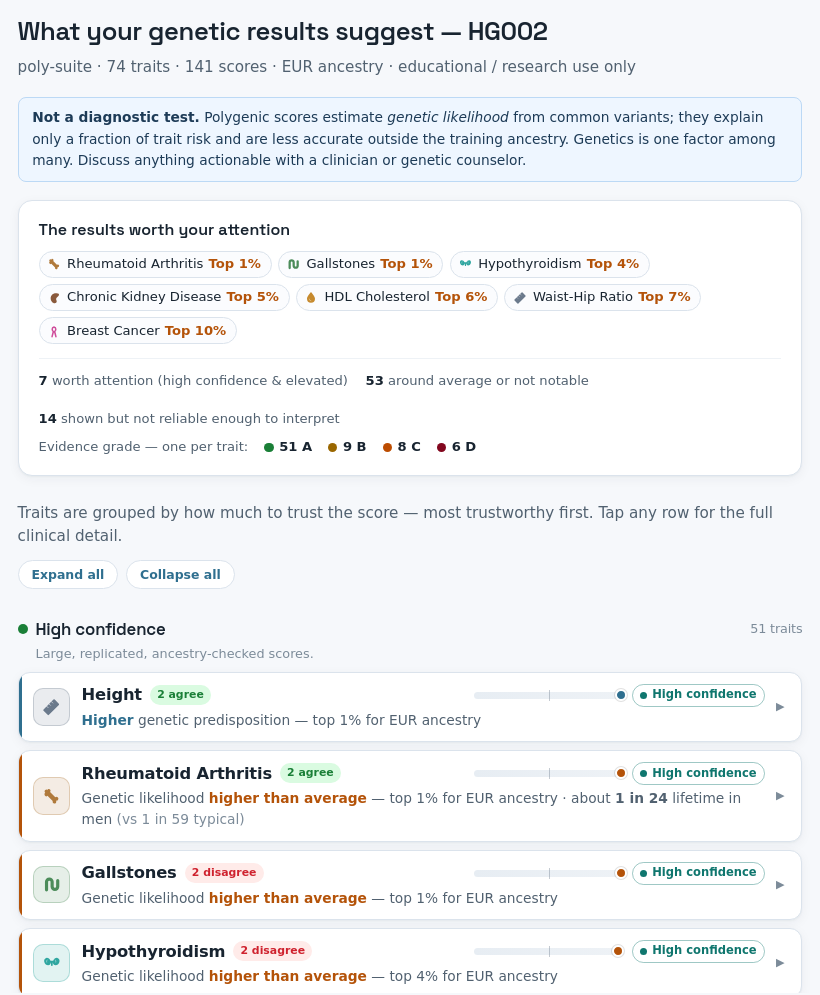

# poly-suite


poly-suite computes polygenic scores (PGS) for one whole-genome sample and turns them into a graded,
referenced result table and a self-contained HTML report. It takes a bwa-aligned GRCh38 BAM or an
all-sites VCF, genotypes the sample at the scoring loci, runs the PGS Catalog's
[pgsc_calc](https://github.com/PGScatalog/pgsc_calc) for scoring and optional ancestry calibration, and
then applies its own quality, ancestry and evidence gates to every score.

**Not for clinical use.** poly-suite is a research and educational tool. A polygenic score explains only part
of a trait's variance, is less accurate outside the ancestry it was trained in, and is not a diagnosis.

## What it does, and what it does not do

It does:

- force-genotype a BAM at every scoring locus, so a hom-ref site is read as dosage 0 rather than as missing
  ([`bin/genotype_prep.sh`](bin/genotype_prep.sh));
- accept a raw all-sites VCF, restricted to the scoring loci before import ([`bin/vcf_input.py`](bin/vcf_input.py));
- score with pgsc_calc 2.3.0 (Nextflow + Docker). With the HGDP+1kGP panel it also places the sample by
  ancestry (FRAPOSA) and gives ancestry-normalised percentiles;
- grade each score A to D from match rate, ancestry fit and published evidence, and write a fixed
  25-column table ([`bin/grade_pgs.py`](bin/grade_pgs.py));
- convert a percentile to an illustrative absolute risk where a per-SD effect and a baseline incidence are
  recorded in [`resources/`](resources/);
- render `report.html`, and record versions and inputs in `provenance.json`;
- optionally replace pgsc_calc's per-sample steps with a cached "fastpath" that gives the same scores in less time.

It does not:

- align reads or call genome-wide variants;
- score chrX, chrY or chrM (pgsc_calc imports the VCF without sample sex, so the sex chromosomes are excluded);
- impute array or low-pass data (on the roadmap in [TODO.md](TODO.md), not built);
- give useful scores from a whole-exome BAM: most scoring loci are off-target, and the gates mark these scores
  as not valid ([docs/wes-limitations.md](docs/wes-limitations.md)).

## Pipeline



*Figure 1. Data flow through [`bin/run.sh`](bin/run.sh). A BAM is force-called at the scoring loci. An
all-sites VCF is restricted to those loci. A previously prepped VCF goes straight to scoring. Dashed: the
panel is optional, and without it scores are uncalibrated. Source: [docs/img/pipeline.mmd](docs/img/pipeline.mmd).*

The workflow engine is a bash orchestrator ([`bin/run.sh`](bin/run.sh)) that calls the upstream Nextflow
pipeline `pgscatalog/pgsc_calc`. The repo has no Nextflow workflow of its own. A Nextflow version of the
orchestrator is listed as an open roadmap item in [TODO.md](TODO.md) and has not been started. The opt-in
fastpath ([`bin/fastpath.py`](bin/fastpath.py)) runs the same PGS Catalog containers directly with Docker,
without Nextflow.

## Place in the OmniGen suite

| Repo | Role |
|---|---|
| [OmniGen](https://github.com/alvin8-git/OmniGen) | Grades and renders the final report. Reads the other three repos' outputs and calls no variants. |
| [pgx-suite](https://github.com/alvin8-git/pgx-suite) | Medicine response, HLA, blood group |
| [SVcaller](https://github.com/alvin8-git/SVcaller) | Structural variants, copy number, SMN, alpha-globin, repeat expansions |
| **poly-suite** (this repo) | Polygenic scores and ancestry. OmniGen reads `pgs_scores.tsv` and computes no PGS itself. |

## Requirements

Measured on the development machine (Linux, kernel 5.15, 64 cores, 125 GB RAM):

| Item | Version or size used here |
|---|---|
| Docker | 28.3.2 (rootless works with [`conf/rootless.config`](conf/rootless.config)) |
| Nextflow | 25.10.4, with Java 17 (OpenJDK 17.0.10 here) |
| pgsc_calc | v2.3.0 (local Nextflow asset; see the pinning note below) |
| Python 3 | 3.13.2, with `pysam` (needed by `--vcf` input and the Neanderthal estimate) |
| samtools | 1.23 here; only to index the FASTA (and recorded in `provenance.json` if present) |
| bcftools / plink2 | not needed on the host: they run in containers (`bcftools:1.21`, `plink2:2.00a5.10`) |
| Disk | panel 15 GB, GRCh38 FASTA 3.0 GB, scorefile cache for the full trait set 2.7 GB, about 240 MB of prepped VCF per sample; fastpath cache 59 GB |
| Memory | full trait set: pgsc_calc `FORMAT_SCOREFILES` needs about 35 GB per run, and the `MATCH_COMBINE` step was seen at 89-108 GB RSS; the fastpath caps containers at 100 GB by default |

Limits of the current code:

- The containers see only one host directory, mounted at the same path: `$OG_MOUNT` (default `/data`). The
  checkout, inputs, caches and outputs must all sit under it. Set `OG_DOCKER_USER` (for example
  `"--user 1000:1000"`) only if your Docker is not rootless and you want files owned by your user.
- `bin/run.sh` runs `nextflow run pgscatalog/pgsc_calc` without `-r`. It uses whichever revision is checked out
  in `~/.nextflow/assets`. Pull v2.3.0 explicitly (see Installation).
- `--bam`, `--vcf` and `--fastpath` need the GRCh38 FASTA: pass `--ref`, or set `POLY_REF` once in your shell.
  Nextflow is taken from `$NF`, else from `PATH`.
- On a 128 GB machine, run at most two full-set samples at a time (three of four parallel runs were OOM-killed).

## Installation

```bash
export OG_MOUNT=/path/to/workspace         # one directory holding the checkout, inputs and references
cd "$OG_MOUNT"
git clone https://github.com/alvin8-git/poly-suite.git
cd poly-suite
nextflow pull pgscatalog/pgsc_calc -r v2.3.0     # not run here: v2.3.0 was already the local asset
python3 -m pip install pysam                     # not run here: pysam 0.23.3 was already installed
tests/selftest.sh                                # unit tests, no network or Docker needed
```

`tests/selftest.sh` should end with `29 unit tests passed` and `ALL SELFTESTS PASSED`.

## Reference data

| File | Size | Needed for |
|---|---|---|
| GRCh38 FASTA with chr-prefixed contigs, `.fai` | 3.0 GB | `--bam`, `--vcf`, fastpath (`--ref`) |
| HGDP+1kGP reference panel `pgsc_HGDP+1kGP_v1.tar.zst` | 15 GB | ancestry calibration (`--panel`), fastpath |
| Harmonized PGS Catalog scorefiles `<PGS id>_hmPOS_GRCh38.txt.gz` | 2.7 GB for 160 scores | all runs (cached, else pgsc_calc downloads them) |

**Shared OmniGen reference bundle (link not yet published):**

```text
https://<REF_BUNDLE_URL>/ref.tar.gz
sha256: <TO_BE_PUBLISHED>
```

The bundle is about 58.5 GB and also serves the sibling repos. poly-suite uses two sub-folders: `ref/GRCh38/`
(only `hg38.canonical.fa` and its `.fai`) and `ref/pgsc/` (the panel). The bundle layout is taken from the
OmniGen deployment notes and was not unpacked here.

**Building them from public sources** (not run here: the files already existed locally):

```bash
# HGDP+1kGP panel from the PGS Catalog FTP (streams with urllib, resumable)
python3 bin/fetch_panel.py \
  https://ftp.ebi.ac.uk/pub/databases/spot/pgs/resources/pgsc_HGDP+1kGP_v1.tar.zst \
  "$OG_MOUNT/ref/pgsc/pgsc_HGDP+1kGP_v1.tar.zst"
# harmonized scorefiles for a PGS list
python3 bin/cache_scorefiles.py cache/scorefiles "PGS003442,PGS005161"
```

**GRCh38 FASTA.** The runs in this repo use UCSC hg38 limited to its 25 canonical contigs (chr1-22, X, Y, M;
the local `.fai` has exactly these, chr1 = 248,956,422 bp). Download
`https://hgdownload.soe.ucsc.edu/goldenPath/hg38/bigZips/hg38.fa.gz` (938 MB) with any HTTP client, then
(not run here):

```bash
gunzip hg38.fa.gz && samtools faidx hg38.fa
samtools faidx hg38.fa chr{1..22} chrX chrY chrM > hg38.canonical.fa
samtools faidx hg38.canonical.fa
export POLY_REF=$PWD/hg38.canonical.fa
```

**Sample BAMs.** GIAB publishes reads for HG001-HG007 at
`https://ftp-trace.ncbi.nlm.nih.gov/ReferenceSamples/giab/data/` (HG002 is under
`AshkenazimTrio/HG002_NA24385_son/`). The GIAB BAMs used here were aligned locally with `bwa` to GRCh38, then
sorted and duplicate-marked with biobambam `bamsormadup` (per their `@PG` header lines). Any bwa-aligned, coordinate-sorted, indexed BAM
with `chr`-prefixed GRCh38 contigs works as `--bam`.

## Quick start: smoke test

```bash
tests/smoke/run.sh            # writes scratch/smoke/ (gitignored)
```

The smoke test runs `bin/run.sh --reuse-prep` with Nextflow, pgsc_calc and Docker on a 19-record VCF.
The VCF is a slice of a GIAB HG002 genotype-prepped VCF at the loci of two small PGS Catalog scores. The test
then checks the raw score sum and matched-variant count of each score:

```text
PASS PGS003442: SUM 0.0107 (expected 0.0107), n_matched 7 (expected 7)
PASS PGS005161: SUM -0.723 (expected -0.723), n_matched 10 (expected 10)
SMOKE PASS
```

It takes 23-39 s here with the containers already pulled. The first run also pulls the pgsc_calc images, and
the report step fetches published performance metrics from the PGS Catalog. PGS003442 equals the full-genome,
panel-calibrated HG002 run exactly. PGS005161 differs from it by one site (chr8:142695299), which that run
excluded at matching.

The smoke test does not cover BAM input or `genotype_prep.sh`, the raw `--vcf` restriction path, ancestry
calibration, or the fastpath. Without a panel both scores are graded D with no percentile, as designed.
[`tests/smoke/build_inputs.py`](tests/smoke/build_inputs.py) records how the slice was made.

## Usage

### `bin/run.sh`: the single entry point

```text
bin/run.sh --sample S --pgs "PGS...,PGS..." --outdir DIR  (one input route)  [options]
```

| Input route | Meaning |
|---|---|
| `--bam BAM` | Force-call the BAM at the scoring loci, then score. `--bootstrap-vcf VCF` is needed only if the scorefile cache does not hold every `--pgs` id. |
| `--vcf VCF` | Score a raw **all-sites** VCF (a row, including `0/0`, at every position). A variant-only VCF roughly halves the match rate. |
| `--reuse-prep VCF` | Score a VCF that `genotype_prep.sh` produced earlier (skips harmonize and prep). |

| Option | Effect |
|---|---|
| `--panel FILE` | HGDP+1kGP panel; enables ancestry calibration and percentiles. Omit for uncalibrated raw sums. |
| `--ref FASTA` | GRCh38 FASTA (needed by `--bam`, `--vcf`, `--fastpath`); default `$POLY_REF` |
| `--sex male\|female` | sex for absolute risk; otherwise inferred from the BAM or the VCF's chrX |
| `--scorefile-cache DIR` | cached `*_hmPOS_GRCh38.txt.gz`; default `$POLY_SCOREFILE_CACHE`, then `cache/scorefiles`. Do not point it at `<outdir>/scorefiles`, which run.sh uses as a staging dir. |
| `--pgs-meta FILE` | `select_pgs.py` metadata for trait names and evidence grades of a custom score set |
| `--work-cache DIR` | shared Nextflow work dir, so the panel is unpacked once across runs |
| `--batch`, `--max-batch-bytes N` | score in size-bounded bins to cap peak memory ([docs/memory-optimization-plan.md](docs/memory-optimization-plan.md)) |
| `--fastpath`, `--fastpath-cache DIR` | use the cached fastpath (also `POLY_FASTPATH=1`); needs `--panel` and a cache from `fastpath.py build` |
| `--nf-timeout SEC` | wall-clock limit per pgsc_calc run (default 28800) |
| `--check-input` | with `--vcf`: restrict, test the plink2 import, print `CHECK_INPUT_OK` or `CHECK_INPUT_FAILED`, exit |
| `--dry-run` | print the plan and exit |

Environment variables: `OG_MOUNT` (host directory mounted into containers, default `/data`), `OG_DOCKER_USER`, `POLY_REF` (default `--ref`), `NF` (nextflow binary, default from `PATH`), `NPROC` (parallel chunks, default 24), `HM_TIMEOUT` / `HM_RETRIES`
(harmonize download guard), `NF_FAIL_GRACE`, `POLY_FASTPATH_THREADS`, `POLY_FASTPATH_MEM_GB`,
`POLY_SAMPLE_NAMES` (fail early on internal-id collisions in a batch). `bin/run.sh --help` prints nothing;
the option list is in the header of `bin/run.sh`.

### Worked example: GIAB HG002 from a BAM, full trait set

Steps 1-2 query the PGS Catalog; step 3 takes hours. Only the id extraction (on an existing 155-score metadata
file) and step 3 with `--dry-run` were run here.

```bash
# 1. choose scores: 2 per trait, all tiers (core, extended, gated) -> metadata JSON keyed by PGS id
python3 bin/select_pgs.py results/meta.json 2 all
PGS=$(python3 -c "import json; print(','.join(sorted(json.load(open('results/meta.json')))))")
# 2. cache their harmonized scorefiles (one-time download)
python3 bin/cache_scorefiles.py cache/scorefiles "$PGS"
# 3. genotype, score, calibrate, grade
bin/run.sh --sample HG002 --pgs "$PGS" --pgs-meta results/meta.json --outdir results/HG002 \
  --bam "$OG_MOUNT/giab/HG002.GRCh38.bam" --ref "$POLY_REF" \
  --panel "$OG_MOUNT/ref/pgsc/pgsc_HGDP+1kGP_v1.tar.zst" --scorefile-cache cache/scorefiles
```

`--pgs-meta` supplies trait names and evidence for the grader. Without it, the `trait` column holds the PGS
id (checked here on the smoke inputs, with and without a 2-entry metadata file).

Step 3 was run here with `--dry-run`, all 155 ids and local GIAB HG002 files. It printed the plan: scorefile-cache
hit, skip harmonize, genotype-prep, infer sex, `pgsc_calc score + --run_ancestry`, grade. The directory holding
each `--panel`, `--vcf`, `--reuse-prep` and `--outdir` path must exist, even for `--dry-run`: run.sh resolves the
paths with `readlink -f` and exits 1 with no message if it cannot. To re-score later without re-genotyping, pass
`--reuse-prep results/HG002/HG002.prepped.vcf.gz` instead of `--bam`.

### Other entry points

| Command | Purpose |
|---|---|
| `bin/fastpath.py build --pgs ... --scorefile-cache DIR --panel P --ref FA [--cache-root cache/fastpath] [--threads 8] [--mem-gb 100]` | one-off cache for a PGS list (about 80 min for 154 scores) |
| `bin/compare_fastpath.py TRUTH_SCORE_DIR NEW_SCORE_DIR SAMPLE [--rtol 1e-9] [--id-map NEW=SAMPLE]` | compare two score dirs; exit 1 on any difference |
| `bin/select_pgs.py [OUT.json] [TOP_N] [TIER]` | choose `TOP_N` (default 2) scores per trait from the PGS Catalog API; `TIER` = `core`, `extended` (default), `gated` or `all` (network; not run here) |
| `bin/grade_pgs.py RESULTS_DIR` | re-grade a finished score dir |
| `bin/report_html.py SCORE_DIR` | re-render `report.html` from `pgs_scores.tsv` |
| `bin/neanderthal.py SCORE_DIR [--vcf VCF]` | Neanderthal-ancestry estimate (seed panel, marked PROVISIONAL) |
| `bin/genotype_prep.sh BAM REF OUT.vcf.gz SCOREFILE...` | the force-calling stage on its own |

The trait set is `LAUNCH_SET` in [`bin/select_pgs.py`](bin/select_pgs.py): 74 traits (25 core, 40 extended,
9 gated). The trait list and the selection rules are in [docs/Documentation.md §6](docs/Documentation.md#6-the-tiered-launch-set).

## Outputs

```text
<outdir>/
  <sample>.prepped.vcf.gz     genotypes at the scoring loci (BAM route; reusable with --reuse-prep)
  samplesheet.csv             pgsc_calc input sheet
  score.log                   pgsc_calc / fastpath log
  score/
    pgs_scores.tsv            the 25-column result table OmniGen reads (one row per score)
    pgs_scores.json           the same rows as JSON
    provenance.json           tool versions, inputs, parameters
    report.html               self-contained report (inline CSS and font)
    neanderthal.tsv           sample, neanderthal_pct, method
    sample_sex.txt            sex used for absolute risk
    pgs_performance.tsv       published AUROC / C-index / R² per score
    <sample>/match/           pgsc_calc match log and summary
    <sample>/score/           aggregated_scores.txt.gz (uncalibrated) or <sample>_pgs.txt.gz + pop_summary.csv (with --panel)
```



*Figure 2. Top of [docs/demo/HG002_report.html](docs/demo/HG002_report.html), the 74-trait GIAB HG002 demo
report generated on 2026-07-12. Traits are grouped by how far the score can be trusted. Each row expands to
the per-score table, the evidence grade and links to the PGS Catalog.*

## Validation

No truth set exists for an individual's polygenic score, so validation here checks internal consistency and
equivalence between code paths. Numbers are from the repo's own records:

| Check | Result | Record |
|---|---|---|
| Unit tests and contract check | 29 tests pass; synthetic run passes the schema and gate checks | `tests/selftest.sh` (run here) |
| Smoke test, real pgsc_calc run on a GIAB HG002 slice | PGS003442 SUM and match count identical to the full HG002 run | `tests/smoke/run.sh` (run here) |
| Fastpath vs pgsc_calc, HG002, HG005, HG006 | 0 differences in 4,830,368 values per sample, graded files included; 23-32 min vs about 4 h per sample | [docs/fastpath.md](docs/fastpath.md) |
| Calibration self-consistency (reference-panel percentiles uniform) | 8 scores, mean 50.1, largest decile deviation 0.001 | [docs/Documentation.md §10](docs/Documentation.md#10-validation) |
| Genotype-prep vs variant-only GIAB benchmark VCF, HG001 | coverage of PGS000018 27.5% → 99.8%; PGS000004 40.3% → 85.6% (the rest are strand-ambiguous SNPs that pgsc_calc excludes) | [docs/Documentation.md](docs/Documentation.md), [TODO.md](TODO.md) |
| HG002, full 74-trait set | 141 of 142 scores pass `min_overlap 0.1`; grades 87 A, 18 B, 19 C, 17 D | [docs/CHANGES.md](docs/CHANGES.md) (2026-07-12) |
| Raw all-sites VCF, HG001 | explicit-genotype fraction 0.9993 at 9.79 M autosomal targets | commit `bee3abc` (README of that commit) |

Known limits: chrX loci are dropped (for the base 69-score set, 4,592 of 81.3 M scoring rows); strand-ambiguous
SNPs are excluded by pgsc_calc; most scores were trained in European-ancestry cohorts, and the grader
downgrades them for other ancestries; the Neanderthal panel is a seed, so its percentages are marked PROVISIONAL;
at a multi-ALT target site the `--vcf` ALT fill uses the first ALT only.

## Troubleshooting

These failures are recorded in [docs/Documentation.md §9](docs/Documentation.md#9-gotchas-learned-on-real-hardware),
[docs/CHANGES.md](docs/CHANGES.md) and [docs/fastpath.md](docs/fastpath.md):

| Symptom | Cause and fix |
|---|---|
| `.command.trace: Permission denied` under rootless Docker | pgsc_calc forces `-u uid:gid`. Pass `-c conf/rootless.config`; `run.sh` does this. |
| Run killed, exit 137, in `FORMAT_SCOREFILES` | Too many parallel runs (about 35 GB each). Run at most two at a time on 128 GB, or use `--batch`. |
| `DOWNLOAD_SCOREFILES` hangs with no exit | A stalled PGS Catalog FTP fetch. Use a full scorefile cache. On a cache miss, `HM_TIMEOUT`/`HM_RETRIES` bound the attempt. |
| `chrX is present ... no sex information was provided` | VCF with chrX passed to pgsc_calc. `run.sh --vcf` now excludes the sex chromosomes. |
| Low match rate, every score graded D | Variant-only VCF: hom-ref loci read as missing. Use the BAM route or an all-sites VCF; check with `--check-input`. |
| `variant with N ALT alleles; limited to 254` | plink2 limit. `scoring_targets.py` caps ALTs at 100. |
| Fastpath killed, exit 137, in the delta match step | Container memory cap too low. Raise `POLY_FASTPATH_MEM_GB` (for example 200). |

## Licence, citation, changes

poly-suite is released under the [MIT licence](LICENSE). Third-party components it runs keep their own licences:
pgsc_calc (Apache-2.0, per its repository), plink2, bcftools/htslib, FRAPOSA and the PGS Catalog utilities in
their containers. PGS Catalog scorefiles and the HGDP+1kGP panel are subject to EMBL-EBI terms of use. The
report embeds the Space Grotesk font under the SIL Open Font License ([resources/SpaceGrotesk-OFL.txt](resources/SpaceGrotesk-OFL.txt)).
The two scorefiles in `tests/smoke/scorefiles/` are unmodified PGS Catalog files (PGS003442, PGS005161).

Citation: no CITATION.cff yet. If you use poly-suite, cite pgsc_calc (Lambert, Wingfield et al., Nature Genetics 2024, [doi:10.1038/s41588-024-01937-x](https://doi.org/10.1038/s41588-024-01937-x))
and the PGS Catalog, plus the publication behind each score you report (its PMID or DOI is in `pgs_scores.tsv`).

Changes: [docs/CHANGES.md](docs/CHANGES.md). Roadmap: [TODO.md](TODO.md). Design and science background:
[docs/Documentation.md](docs/Documentation.md); fastpath design: [docs/fastpath.md](docs/fastpath.md).
